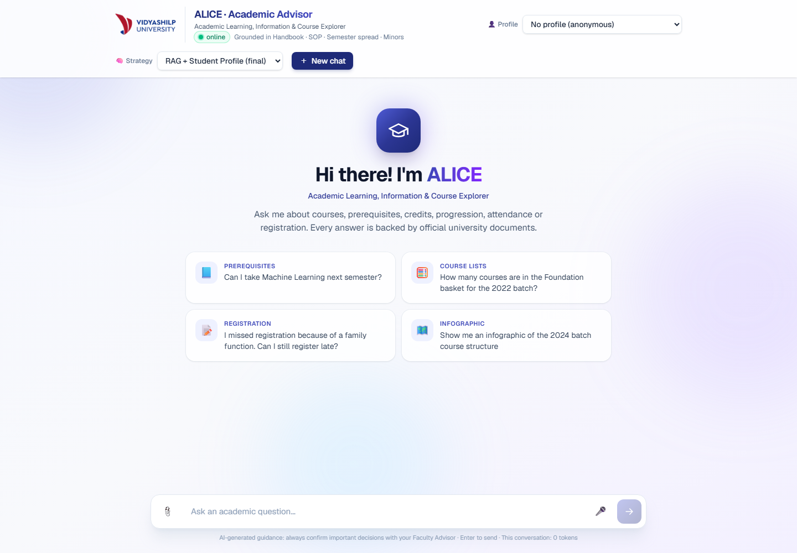
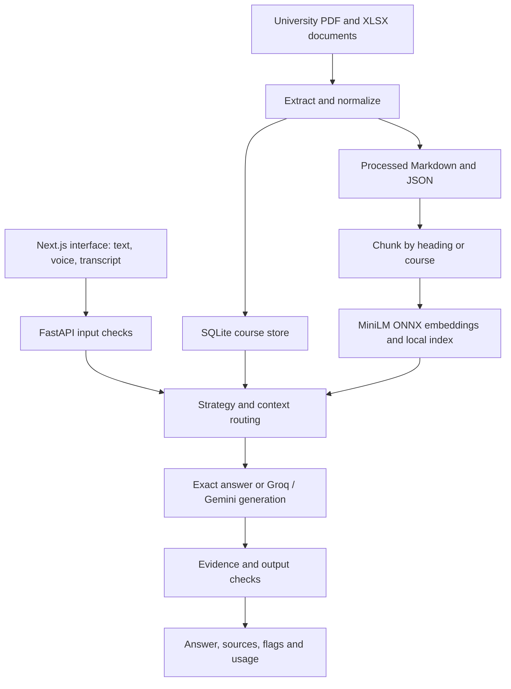
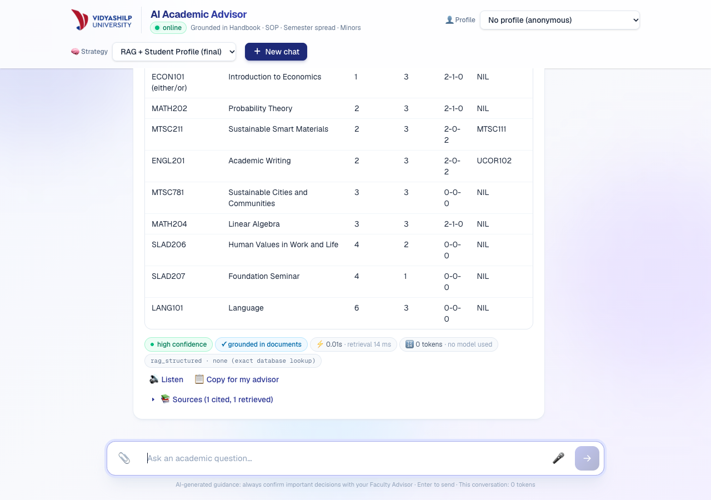
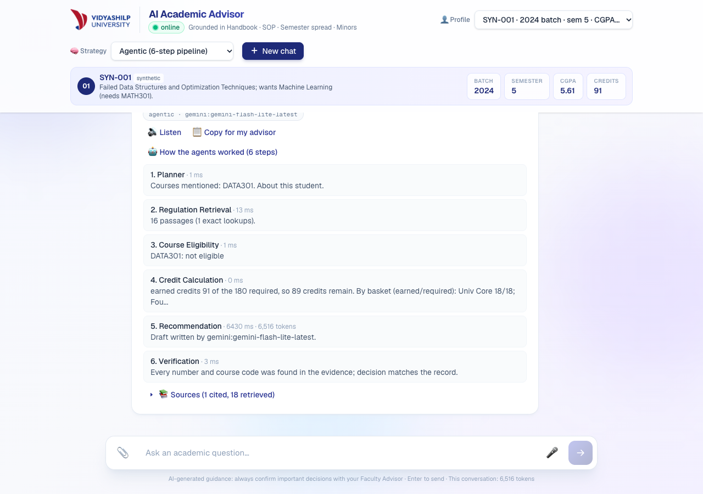
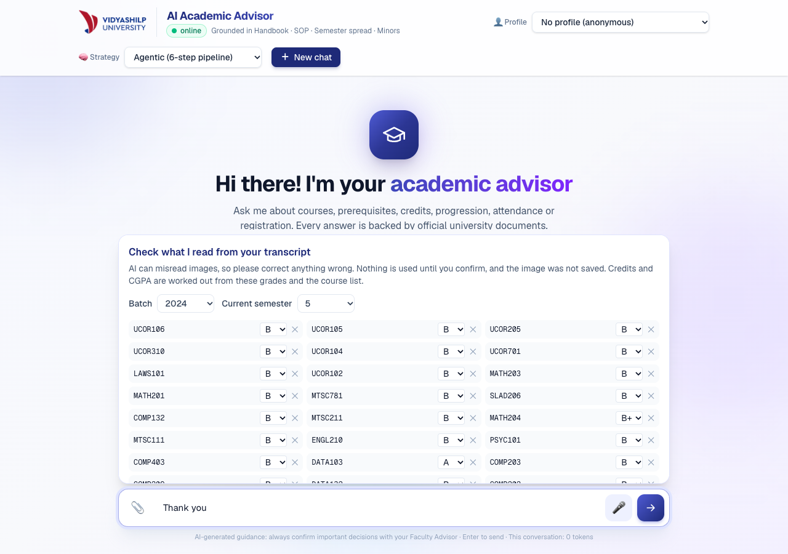
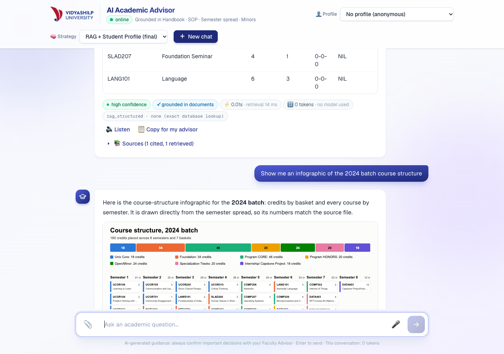

# ALICE — AI Academic Advisor

**Academic Learning, Information & Course Explorer**

[GitHub repository](https://github.com/devalpauriyal-cmd/Academic-Advisor_GenAI)

A document-grounded academic-advising prototype for Vidyashilp University. ALICE combines retrieval-augmented generation (RAG), exact SQL course lookups and student context to explain courses, prerequisites, credits and academic regulations with source references.

Built as a DATA308 academic project. It provides advisory guidance; it does not register students, change university records or issue official eligibility decisions.



## Features

- **Document-based advising:** searches the supplied handbook, student SOP, semester structures and minor-course lists. RAG modes attach document and section references, and can ask for clarification or report missing information.
- **Exact course answers:** SQLite queries supply course tables, counts, credits, semesters and prerequisite details, avoiding reliance on a language model to count rows.
- **Five strategies:** baseline, structured prompting, RAG, RAG with student context, and a staged agentic workflow.
- **Student context:** 10 synthetic profiles, conversation-based facts and corrections, batch-specific guidance, and clarification when stated facts disagree with a selected record.
- **Evidence checks:** validates citations and selected numeric/course claims; may attempt one repair and lowers confidence when verification still fails. These checks are heuristic, not a guarantee of correctness.
- **Multimodal interaction:** microphone transcription, transcript-image extraction followed by student review, read-aloud responses and database-generated SVG course infographics.
- **Visible execution details:** provider, token usage, response/retrieval times, estimated cost where configured, and agent traces.
- **Safety controls:** identifier scrubbing, rule-based refusals, optional provider-based injection classification, output checks, upload validation and a best-effort per-instance request limit.

## Methodology and workflow



1. **Extract:** `backend/extract_data.py` reads two PDFs and two workbooks from `data/raw/`, producing policy text, course records and a SQLite database. Extraction includes explicit handling of source formatting problems.
2. **Index:** `backend/ingest.py` splits Markdown by headings and longer passages, adds course records, embeds them locally with `all-MiniLM-L6-v2`, and writes normalized vectors plus citation metadata.
3. **Retrieve and route:** semantic NumPy search is combined with exact course-code, prerequisite, semester and basket lookups. Some requests return directly from structured data without a generation call.
4. **Build context:** applicable modes reconcile profiles, confirmed transcript records and user-stated facts; incomplete or conflicting personal context can trigger clarification.
5. **Answer and verify:** provider-backed responses use Groq with Gemini fallbacks. The system validates structured responses, checks supporting evidence and exposes uncertainty, source conflicts and verification failures.
6. **Display:** the browser renders Markdown answers, sources, flags, execution details, optional agent traces and infographics.

### Strategy comparison

| API value | Implemented approach |
| --- | --- |
| `baseline` | Plain model generation without retrieved documents; experimental control. |
| `structured` | Structured prompt and response schema, without document retrieval. |
| `rag` | Retrieved university-document context and citation/grounding rules. |
| `rag_structured` | RAG plus exact lookups, student context, clarification and evidence checks; default. |
| `agentic` | Planner, Retrieval, Eligibility, Credits, Recommendation and Verification stages. Most stages use code and database logic; generation and possible repair use providers. |

Shared greeting and safety paths can answer before strategy-specific processing. The baseline and structured modes are comparison modes and do not provide the document guarantees intended by the RAG modes.

## Technology stack

| Layer | Components |
| --- | --- |
| Frontend | Next.js 16.3.6, React 19.2.8, TypeScript, Tailwind CSS 4, React Markdown |
| API | Python, FastAPI, Uvicorn, Pydantic |
| Retrieval | ONNX Runtime, Hugging Face Tokenizers, MiniLM embeddings, NumPy cosine-style search |
| Structured data | SQLite, JSON, Markdown |
| Extraction | pypdf, openpyxl |
| Providers | Groq SDK and Google Gen AI SDK; configurable text, Whisper, vision and TTS models |
| Validation | pytest, HTTPX/TestClient, ESLint, TypeScript, independent spreadsheet/database audit |
| Optional documentation | matplotlib, Pillow, Node `docx`; legacy report builder also requires Chrome and pandoc |

Model names in `backend/config.py` are project defaults, not a promise that each provider currently offers them. Override them in your local environment as needed.

## Repository structure

```text
.
├── backend/
│   ├── main.py                 # FastAPI routes and middleware
│   ├── advisor.py              # Strategy orchestration
│   ├── agents.py               # Staged advising and verification
│   ├── structured.py           # Exact SQL queries and routing
│   ├── memory.py               # Facts and follow-up context
│   ├── evidence.py             # Evidence checks
│   ├── multimodal.py           # Audio, transcript and SVG support
│   ├── extract_data.py         # Source-document extraction
│   ├── ingest.py               # Chunking and index construction
│   ├── verify_data.py          # Independent source/store audit
│   ├── index/                  # Committed vectors and deployment data
│   ├── models/                 # Committed ONNX model and tokenizer
│   ├── requirements.txt
│   └── .env.example
├── frontend/                   # Next.js application and npm lockfile
├── data/
│   ├── raw/                    # Canonical university PDFs/XLSX files
│   ├── processed/              # Extracted text, JSON and courses.db
│   └── synthetic/              # Invented profiles and multimodal fixtures
├── eval/                       # Tests, model evaluation scripts, historical results
├── docs/
│   ├── figures/                # Screenshots and existing architecture figures
│   ├── reference/               # Original assignment brief
│   ├── AUDIT.md                 # Audit findings and validation evidence
│   ├── DATA_AND_ATTRIBUTION.md   # Data, model and publication notes
│   ├── PUBLISHING.md            # Proposed publication scope
│   └── demo.md                  # Original demonstration walkthrough
├── scripts/check_repository.py  # Credential-pattern and size checks
├── requirements.txt             # Root runtime install entry point
└── requirements-dev.txt         # Runtime plus test dependencies
```

The index and model are retained so a checkout can start without rebuilding embeddings. Copies in `backend/index/data/` are intentional: deployment of `backend/` alone needs runtime data. The ONNX file is approximately 86 MiB and makes clones larger. Exact duplicate root-level source documents were removed from the publishable tree; the canonical files remain under `data/raw/`.

## Installation

### Prerequisites

- Python 3.11 or newer; this audit used **Python 3.13.15 on Windows**.
- Node.js 20.9 or newer and npm; this audit used **Node.js 24.21.0**.
- Internet access for dependency installation, the frontend font download during builds, and provider-backed features.
- Your own Groq and Gemini credentials for the corresponding text/audio/image services. Some deterministic answers work without provider calls; complete startup and feature use should be configured with valid keys.

The runtime requirements preserve the existing version ranges. `backend/requirements-lock.txt` records the environment used during this audit; it is an optional full dependency snapshot, not a guarantee of compatibility with every operating system or Python version.

### Windows PowerShell

Run from the repository root:

```powershell
python -m venv backend/.venv
backend/.venv/Scripts/python.exe -m pip install -r requirements-dev.txt
Copy-Item backend/.env.example backend/.env
Copy-Item frontend/.env.local.example frontend/.env.local
```

Edit `backend/.env` to replace the provider-key placeholders. Leave `frontend/.env.local` pointing at `http://localhost:8000` for local use.

Start the backend:

```powershell
backend/.venv/Scripts/python.exe -m uvicorn main:app --app-dir backend --reload --port 8000
```

In a second terminal:

```powershell
cd frontend
npm ci
npm run dev
```

Open **http://localhost:3000**. Verify backend startup at **http://localhost:8000/health**.

### macOS / Linux

```sh
python3 -m venv backend/.venv
backend/.venv/bin/python -m pip install -r requirements-dev.txt
cp backend/.env.example backend/.env
cp frontend/.env.local.example frontend/.env.local
# Edit backend/.env before starting the server.
backend/.venv/bin/python -m uvicorn main:app --app-dir backend --reload --port 8000
```

In another terminal, run `cd frontend && npm ci && npm run dev`.

### Configuration

| Variable | Purpose |
| --- | --- |
| `GROQ_API_KEY`, `GEMINI_API_KEY` | Backend-only provider credentials. |
| `NEXT_PUBLIC_API_URL` | Public browser URL for the API, not a secret. |
| `ALLOWED_ORIGINS` | Comma-separated permitted browser origins; example uses `http://localhost:3000`. |
| `GROQ_MODELS`, `GEMINI_MODELS` | Ordered text-generation model lists. |
| `LLM_PIN` | Optional `provider:model` pin for comparable evaluations. |
| `TOP_K`, `MIN_RELEVANCE` | Retrieval count and relevance threshold. |
| `LLM_TIMEOUT_S`, `LLM_DEADLINE_S` | Per-provider timeout and fallback-loop deadline. |
| `WHISPER_MODEL`, `VISION_MODELS`, `TTS_MODELS` | Multimodal model overrides. |
| `PROMPT_GUARD_MODEL`, `PROMPT_GUARD_THRESHOLD` | Optional external classifier configuration. |
| `RATE_LIMIT_PER_MIN` | Best-effort request limit per IP and server instance. |

See `backend/config.py` for all defaults. Estimated costs use the project's static price table and may differ from actual billing.

## Rebuild the data and index

Prebuilt assets are included; these commands are optional unless the source documents or synthetic profiles change. Run in order from the root using the backend virtual environment:

```powershell
backend/.venv/Scripts/python.exe -X utf8 backend/extract_data.py
backend/.venv/Scripts/python.exe -X utf8 backend/make_profiles.py
backend/.venv/Scripts/python.exe -X utf8 backend/ingest.py
backend/.venv/Scripts/python.exe -X utf8 backend/verify_data.py
```

On macOS/Linux, replace `backend/.venv/Scripts/python.exe` with `backend/.venv/bin/python`. Rebuilding overwrites generated assets; rerun ingestion after changes so deployment copies stay synchronized.

The current assets contain **148 catalogue entries, 439 indexed chunks, 470 SQL course rows and 10 synthetic profiles**. These counts describe different representations and should not be treated as unique course counts.

## Validation and evaluation

```powershell
backend/.venv/Scripts/python.exe -X utf8 -B -m pytest eval -q -p no:cacheprovider
backend/.venv/Scripts/python.exe -X utf8 -B backend/verify_data.py
backend/.venv/Scripts/python.exe -X utf8 -B scripts/check_repository.py --history
cd frontend
npm run lint
npm run build
```

Checks on **8 November 2026**:

| Check | Observed result |
| --- | --- |
| Existing automated tests | 296 passed; one upstream deprecation warning. |
| Independent data audit | Zero spreadsheet/store mismatches; 47 source-document problems reported. |
| API/retrieval smoke checks | 11 passed, including real ONNX retrieval, startup, exact answers, refusals and upload validation. |
| Frontend | ESLint and production build passed. The build required Google Fonts network access. |
| Credential-pattern scan | No matches in publishable files or 200 reachable historical Git blobs; heuristic coverage only. |

Provider generation, live speech/vision services and full live-model evaluations were **not rerun** in this audit. The API smoke check stubbed the external injection classifier; it did not validate that service. See [audit details](docs/AUDIT.md).

The repository contains **43 evaluation cases**. Live evaluation scripts can consume provider quota and overwrite historical output files:

```powershell
$env:LLM_PIN = "groq:openai/gpt-oss-120b"
backend/.venv/Scripts/python.exe -X utf8 eval/run_eval.py
backend/.venv/Scripts/python.exe -X utf8 eval/run_agentic.py
Remove-Item Env:LLM_PIN
```

Additional scripts cover regression, memory, security and multimodal scenarios. `eval/run_eval.py --rescore` rescans saved responses without generation calls but still rewrites summary outputs. Historical files are evidence of earlier runs, not performance claims for this checkout. Scoring is based on rules and keywords and can misclassify paraphrases.

## API

| Method and route | Purpose |
| --- | --- |
| `GET /health` | Server status, configured model chain and available strategies. |
| `GET /students` | Summary fields for synthetic demo profiles. |
| `POST /chat` | Answer a question with optional profile, history and confirmed session record. |
| `POST /voice/transcribe` | Multipart audio to transcript text. |
| `POST /transcript/read` | Multipart transcript image to reviewable academic fields. |
| `POST /speech` | Text to generated WAV audio. |
| `GET /infographic/{batch}` | SVG course structure; optional `minor` and `semester` filters. |

Example request:

```json
{
  "message": "What is the minimum attendance requirement?",
  "strategy": "rag_structured",
  "student_id": null,
  "conversation_history": []
}
```

Responses include `answer`, `confidence`, `grounded`, `sources`, clarification/conflict flags, provider, timings and usage. Extra fields expose agent traces, privacy notices, attachments and service availability. See `backend/schemas.py` for the complete contract. Swagger/ReDoc/OpenAPI routes are disabled in the app.

## Screenshots

The opening screenshot was captured from this local checkout during repository preparation. The following supplied screenshots document earlier UI states; wording and branding may differ from the current ALICE interface. They use synthetic demo records.

| Course lookup | Agent trace |
| --- | --- |
|  |  |

| Transcript confirmation | Course infographic |
| --- | --- |
|  |  |

See [the demo walkthrough](docs/demo.md) for example interactions. Its deployment links and historical provider-limit statements have not been independently verified in this audit.

## Limitations

- This is a university-specific academic prototype with 2026 source material, not a general advising service. The current-term default comes from the supplied term-context document, not a live university calendar.
- The source files contain undefined prerequisites, placeholder names/codes and conflicting credit requirements. Extraction is heuristic; some PDF tables were transcribed manually.
- Retrieval and evidence checks can miss or misinterpret information. A source citation or high confidence is not proof of correctness. Important decisions require university confirmation.
- Provider calls need valid keys and available models; limits, latency, model support and billing depend on the account. No current latency or accuracy guarantee is made.
- The demo profile selector has **no authentication or authorization**. Use only synthetic profiles; it is not ready to serve real student records.
- PII removal uses patterns. Audio and images are sent to external providers; requesting omission of identifiers from extraction output does not remove them from the uploaded image before transmission.
- Application code processes uploads in memory, but this does not establish a provider retention policy. Browser speech synthesis behavior depends on the browser/OS.
- CORS, a forwarded-IP request limit and injection checks are limited controls. The classifier fails open on service errors, and the request limit is not a distributed quota.
- Legacy report generation is incomplete in this checkout: `docs/build_report.py` needs missing result/narrative files and has a macOS Chrome path. Synthetic audio regeneration also depends on macOS `say` and system fonts.
- Existing reports and diagrams contain historical counts and claims. This README and the audit describe the checked source tree.

## Data, attribution and publishing

University documents, the assignment brief, branding and the pretrained embedding model are third-party materials. Student profiles and multimodal fixtures are synthetic. See [data and attribution](docs/DATA_AND_ATTRIBUTION.md) for the source inventory, model attribution and redistribution limits.

No project-wide open-source license has been assigned: an owner must choose a license for code they are entitled to license, separately from third-party material. Local credentials, environments, dependency folders, build caches, backups and private uploads are ignored. Run the repository check and review the publication scope before pushing.

This publication starts a fresh Git history while retaining the original source attribution in [project provenance](docs/PROVENANCE.md).

For a resume, describe your own contribution accurately. A project-level description is: **“Document-grounded academic advisor using FastAPI, Next.js, ONNX semantic retrieval and SQLite, with source citations, student-context handling and multimodal input.”**
